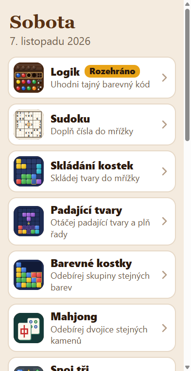
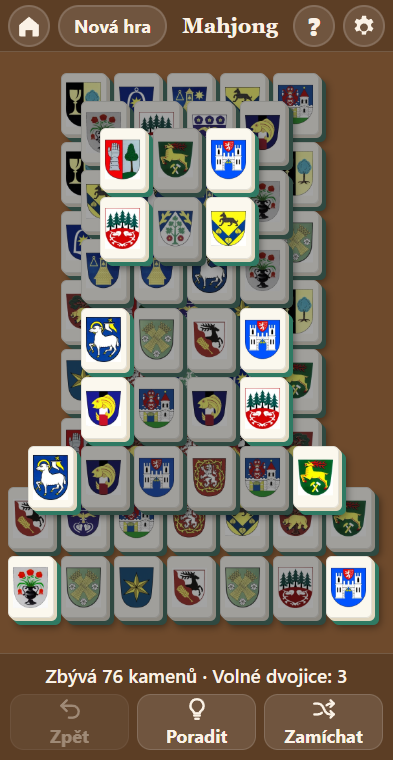
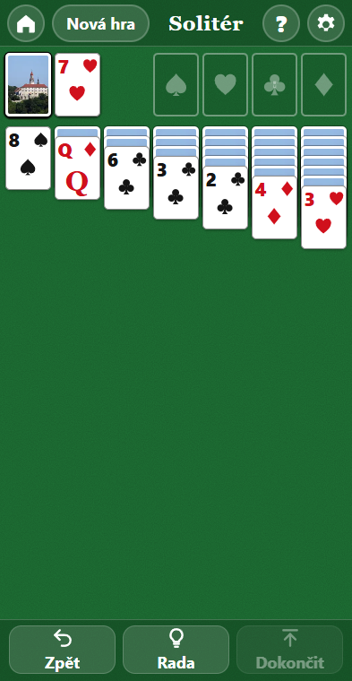

# Vítkovy hry

Malá sbírka her pro mobilní telefon. Fungují i bez internetu.
Velká tlačítka, žádné reklamy, žádné odpočítávání času, žádné účty. Všechno, co hráč vidí, je česky.

  
  
  

> [!IMPORTANT]
> **Tento projekt je ze 100 % „vibe-coded“.**
> Každý řádek kódu, každou hru, rozvržení, ikonu, test i tohle README napsal AI agent
> ([Claude Code](https://claude.com/claude-code)) podle obyčejných požadavků v češtině.
> Kód nikdo ručně nepsal ani nekontroloval.

## Hry

| Hra             | Složka                   | Co to je                                                                                                                  |
| --------------- | ------------------------ | ------------------------------------------------------------------------------------------------------------------------- |
| Logik           | `games/logik/`           | Uhodni tajný barevný kód                                                                                                  |
| Sudoku          | `games/sudoku/`          | Klasické sudoku 9×9 (nebo 6×6) s poznámkami a nápovědou                                                                   |
| Skládání kostek | `games/skladani-kostek/` | Skládačka: přetahuj tvary do mřížky a plň celé řady                                                                       |
| Padající tvary  | `games/padajici-tvary/`  | Tvary ovládané tlačítky místo gest; pomalu padají a postupně zrychlují, hru jde kdykoli zastavit tlačítkem Pauza; v nastavení jde padání vypnout |
| Barevné kostky  | `games/barevne-kostky/`  | SameGame: ťukej na skupiny stejně barevných kostek, zbytek spadne dolů; volitelně vždy řešitelné hrací plochy             |
| Mahjong         | `games/mahjong/`         | Mahjong solitér: odebírej dvojice volných kamenů; klasické kameny, obrázky, sady fotek (kočky, Náchodsko, znaky obcí) nebo kreseb (houby, ptáci, ovoce a zelenina) |
| Pexeso          | `games/pexeso/`          | Otáčej karty a hledej dvojice stejných obrázků; fotky (Náchodsko, kočky, znaky obcí), kresby (houby, ptáci, ovoce a zelenina) nebo obrázky, 6 až 21 dvojic, bez spěchu |
| Spoj tři        | `games/spoj-tri/`        | Prohazuj sousední kameny a skládej řady po třech; tvary, sady fotek (kočky, Náchodsko, znaky obcí) nebo kreseb (houby, ptáci, ovoce a zelenina) |
| Přelévání       | `games/prelevani/`       | Přelévej barevné vrstvy mezi zkumavkami, dokud v každé nezůstane jedna barva; úrovně postupně přidávají barvy             |
| Hanojské věže   | `games/hanojske-veze/`   | Přesouvej disky mezi třemi tyčemi, větší nikdy na menší; 3 až 8 disků, Poradit a Zpět                                     |
| Spojování čísel | `games/spojovani-cisel/` | Posouvej a spojuj stejná čísla (jako 2048): šipky nebo tah prstem, Zpět, volitelně fotky nebo kresby na kostkách         |
| Cesta ven       | `games/cesta-ven/`       | Posouvej auta (nebo kostky) na parkovišti, ať červené vyjede ven; úrovně postupně těžší, Poradit a Zpět                   |
| Patnáctka       | `games/patnactka/`       | Posuvná skládačka: seřaď čísla posouváním na prázdné místo; desky 3 × 3, 4 × 4 a 5 × 5, mírné až úplné zamíchání, Zpět    |
| Zavři čísla     | `games/zavri-cisla/`     | Kostková hra (Shut the Box): hoď kostkami a zavři destičky se stejným součtem; 9, 10 nebo 12 destiček, statistika         |
| Kostky          | `games/kostky/`          | Klasické kostky (jedničky a pětky) se šesti kostkami proti počítači: házej, dokud se nebojíš, a body si zapiš; tři soupeři od začátečníka po mistra, hra do 3 000, 5 000 nebo 10 000 |
| Solitér         | `games/soliter/`         | Klasický solitér (Klondike)                                                                                               |
| FreeCell        | `games/freecell/`        | Solitér se čtyřmi volnými políčky                                                                                         |
| Pyramida        | `games/pyramida/`        | Odebírej dvojice karet se součtem 13                                                                                      |
| Pavouk          | `games/pavouk/`          | Pavouk (Spider)                                                                                                           |
| Oko bere        | `games/oko-bere/`        | Česká karetní hra do 21 s mariášovými kartami proti počítači; body za kola do 5, soupeř s náhodným jménem, mírný ★☆ nebo chytrý ★★                |
| Oko bere plus mínus | `games/oko-bere-plus-minus/` | Do 21 proti počítači s kartami od esa do desítky a čtyřmi kartami plus a mínus, které upraví součet; do 3 vyhraných kol |
| Prší            | `games/prsi/`            | Klasické české prší s mariášovými kartami proti jednomu nebo dvěma soupeřům (jeden útočí, druhý šetří karty); sedma, eso, svršek mění barvu, Zpět |

Výběr her ukazuje nahoře dnešní den a datum a pod ním seznam her. Hry řadí podle toho, jak často se hrají
(hra se posune nahoru až po 5 spuštěních), u rozehraných her ukazuje štítek „Rozehráno“. Na telefonu je seznam
v jednom sloupci, na tabletu a počítači ve dvou. V Nastavení jde zapnout, aby u každé hry bylo vidět, kolikrát
se hrála.

## Jak to spustit

Nic se neinstaluje ani nesestavuje. Jsou to obyčejné webové stránky (HTML soubory), stačí webový prohlížeč.

### 1. Hrát rovnou na telefonu (nejjednodušší)

1. Otevři v Chromu <https://hhvitek.github.io/hhvitek-games/> (až bude zapnuté GitHub Pages).
2. Menu ⋮ → **Přidat na plochu**. Na ploše se objeví jedna ikona „Vítkovy hry“.
3. Ťukni na hru. Tlačítko s domečkem vlevo nahoře vede zpět na výběr her.

Po první návštěvě hry fungují i bez internetu.

### Verze a aktualizace

Nové verze se do telefonu stahují samy na pozadí, když je připojení k internetu, a ukážou se při dalším otevření.
Ve výběru her v **Nastavení** v části „Verze aplikace“ je vidět číslo verze, kdy vyšla a kdy se stáhla do tohoto
zařízení. Tlačítko „Zkontrolovat aktualizace“ hned zjistí, jestli je novější, a „Co je nového“ ukáže poslední změny.
Všechny změny po verzích jsou v [CHANGELOG.md](CHANGELOG.md).

### 2. Stáhnout a otevřít z disku

1. Na GitHubu: zelené tlačítko **Code** → **Download ZIP** a rozbal ho (nebo `git clone https://github.com/hhvitek/hhvitek-games.git`).
2. Ve složce dvakrát klikni na `index.html`. Otevře se výběr her v prohlížeči.

Nech pohromadě celou složku: hry potřebují `games/registry.js` a obrázky ze složky `images/`.
Z disku se nedá použít „Přidat na plochu“ ani offline režim, k tomu je potřeba varianta 1.

### Uložená data

Rozehrané hry, nastavení a rekordy se ukládají jen v prohlížeči daného zařízení, nikam se neposílají.
Tlačítko **Smazat uložená data** ve výběru her (dole tlačítko **Nastavení**) je všechna smaže (po potvrzení). Kopie her pro offline režim zůstanou.

## Obrázky

Fotky a znaky obcí ve složce `images/` pocházejí z [Wikimedia Commons](https://commons.wikimedia.org/)
pod svobodnými licencemi (CC BY, CC BY-SA, CC0, volné dílo). Byly zmenšené a oříznuté.
Kresby hub, ptáků a ovoce a zeleniny (`images/mushrooms/`, `images/birds/`, `images/produce/`) vznikly pro tyto hry
a jsou volným dílem ([CC0](https://creativecommons.org/publicdomain/zero/1.0/)). Autoři, licence
a odkazy na zdroj jsou v `images/sets.js` a ve hrách: Mahjong, Pexeso, Spoj tři a Spojování čísel → Nastavení → Autoři obrázků;
karetní hry uvádějí autory fotky zámku a erbu Náchoda v nastavení u rubu karet.

## Kontakt

Dotazy, chyby a nápady: založ issue na <https://github.com/hhvitek/hhvitek-games>.
Stejný kontakt je i ve výběru her v **Nastavení** v části „O aplikaci“.

## Licence

Kód je pod licencí [GNU GPL verze 3](LICENSE) nebo kterékoli pozdější verze (GPL-3.0-or-later). Kdo hry upraví a dál šíří, musí je šířit pod stejnou licencí i se zdrojovým kódem. Fotky a znaky ve složce `images/` pod ni nespadají a ponechávají si své původní licence; kresby jsou CC0.
